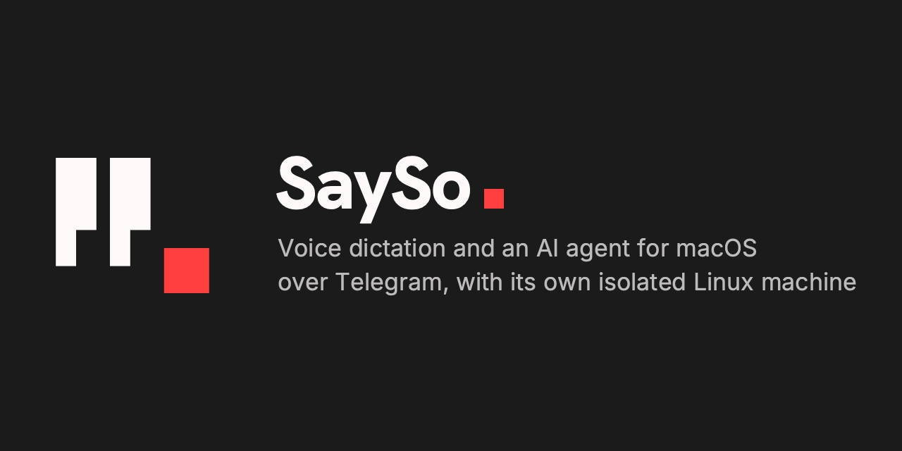
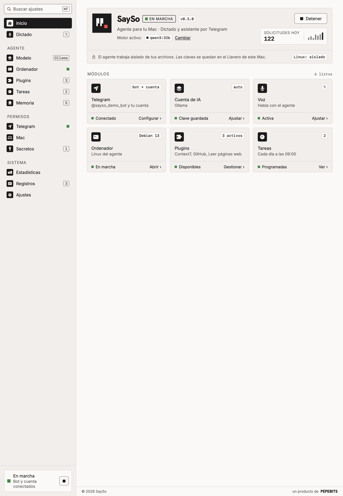
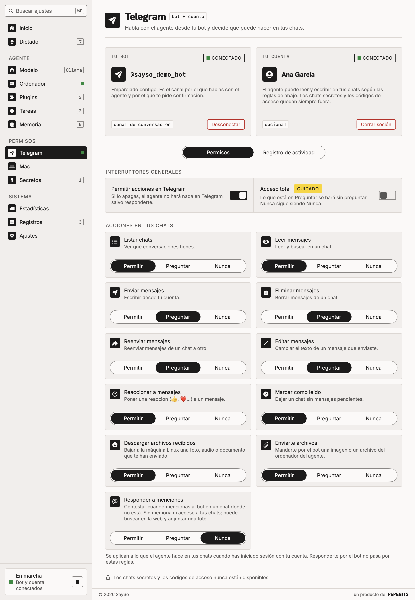

<p align="center"></p>

<p align="center"><em><a href="README.md">English</a> · Español</em></p>

**SaySo** es una app nativa de macOS que convierte lo que dices en cosas hechas. Mantén una
tecla y habla: un agente de IA te responde en pantalla, escribe en tus chats de Telegram,
programa tareas y ejecuta comandos en una máquina Linux propia, lejos de tus archivos. Todo lo
que sale del Mac pasa por las reglas que tú pones, y te pregunta antes cuando así lo quieres.

- 🎙️ **Dictado en tu Mac**: mantén ⌥, o el atajo que elijas, y Whisper transcribe en local; o mantén una conversación hablada con el agente
- 💬 **Telegram, de dos formas**: habla con el agente desde tu propio bot y, si quieres, deja que lea, busque, responda, reenvíe y envíe desde tu cuenta, notas de voz y archivos incluidos
- 🐧 **Su propia máquina Linux**, aislada con Virtualization.framework, para ejecutar comandos, instalar herramientas, navegar por la web y transcribir audio
- ⏰ **Tareas programadas** para ti o para otras personas, con varios destinatarios y la opción de enviar sin preguntar
- 🧠 **Memoria que puedes editar**: notas marcadas como instrucciones o datos, que se aplican en cada conversación
- 🧩 **Plugins** sobre MCP, y complementos que se ejecutan dentro de la máquina Linux
- 🛡️ **Permisos y protecciones**: Permitir, Preguntar o Nunca para cada acción, secretos en el Llavero y ocultos antes de llegar al modelo, y una segunda revisión de las acciones hacia fuera cuando el agente ha leído contenido de otros
- 🔌 **El modelo que quieras**: Claude, OpenAI, OpenRouter, Grok, o uno local con Ollama o LM Studio
- 🌍 En español, inglés, gallego, francés y portugués

<p align="center">
  
  
</p>

## 🚀 Primeros pasos

Necesitas **macOS 15 o posterior en un Mac con Apple Silicon**, y una cuenta de un proveedor
de modelos o un modelo local.

1. 📥 **Descarga** el último `SaySo-x.y.z.dmg` de [Releases](https://github.com/Pepebits/sayso/releases). Está firmado y notarizado por Apple.
2. 📂 **Instala**: arrastra SaySo a Aplicaciones y ábrelo. La guía de bienvenida pide el micrófono y la Supervisión de entrada, y te lleva por el resto.
3. 🔑 **Elige un modelo** en **Modelo**: pega una clave de API, que se guarda en el Llavero, o apunta a Ollama o LM Studio.
4. 🤖 **Opcional, Telegram**: crea un bot con [@BotFather](https://t.me/BotFather) y pega su token en **Telegram**. Para que el agente trabaje con tus propios chats, inicia sesión también con tu cuenta, con un `api_id` y un `api_hash` tuyos de [my.telegram.org](https://my.telegram.org).

## 🧭 Cómo funciona

```
 voz ─────▶ Dictado ─┐                      ┌─▶ Bot y cuenta de Telegram
                     ├─▶ Agente ─▶ Permisos ┼─▶ Mac: calendario, recordatorios, notas
 bot de Telegram ────┘     │                └─▶ Máquina Linux: comandos, web, plugins
                           └─▶ proveedor del modelo
```

El bucle del agente corre en el Mac y habla con el proveedor de modelos que elijas. Toda
acción con efecto fuera de la máquina Linux pasa por un único motor de permisos, que la permite, te pregunta en
el Mac o la rechaza, y apunta lo que ha pasado. El código que el agente escribe o descarga
solo se ejecuta en la máquina Linux.

| Módulo | Qué hace |
|---|---|
| `SaySoCore` | Modelos y contratos compartidos, sin dependencias |
| `SaySoStore` | SQLite con GRDB: reglas, actividad, memoria, tareas, conversaciones |
| `SaySoPermissions` | Motor de permisos, scripts del Mac, Llavero y ocultación de secretos |
| `SaySoAgent` | Proveedores de modelos, bucle del agente, herramientas, bot de Telegram, cliente MCP, protecciones |
| `SaySoDictation` | Atajo global, captura de audio y transcripción con Whisper |
| `SaySoVM` | La máquina Linux, con Virtualization.framework |
| `SaySoTDLib` | Sesión opcional de la cuenta de Telegram con TDLib |
| `SaySoUI` | Sistema de diseño y todas las pantallas |
| `SaySoApp` | La app: lo une todo |

## 🛠️ Compilar desde el código

Hace falta Xcode 16 o posterior (Swift 6).

```bash
git clone https://github.com/Pepebits/sayso.git
cd sayso
scripts/make-app.sh
open build/SaySo.app
```

`scripts/make-app.sh` crea `build/SaySo.app` en modo debug; con `release`, la versión
optimizada. Firma con tu Developer ID si lo tienes en el Llavero, para que macOS conserve los
permisos concedidos entre compilaciones. `scripts/release.sh` firma, notariza y crea el DMG;
su cabecera dice lo que necesita la primera vez.

## 🧪 Tests

```bash
swift test
```

Para guardar cada pantalla como PNG, en claro y en oscuro:

```bash
SAYSO_SCREENSHOTS=/tmp/sayso swift test --filter ScreenSnapshotTests
```

`scripts/check-strings.py <código>` comprueba que una traducción tiene todas las claves y
huecos de la inglesa.

## 🔒 Privacidad

El dictado se transcribe en tu Mac. Las conversaciones, la memoria, las tareas y el registro de
actividad se quedan en él, en SQLite, y los secretos en el Llavero. Al proveedor del modelo le
llega lo que le pides al agente y lo que leen sus herramientas para responderte. SaySo no
tiene servidor propio ni envía telemetría.

## 📄 Licencia

[MIT](LICENSE) © Pepebits. Los componentes de terceros y sus licencias están en
[ThirdPartyNotices.txt](Resources/ThirdPartyNotices.txt).
