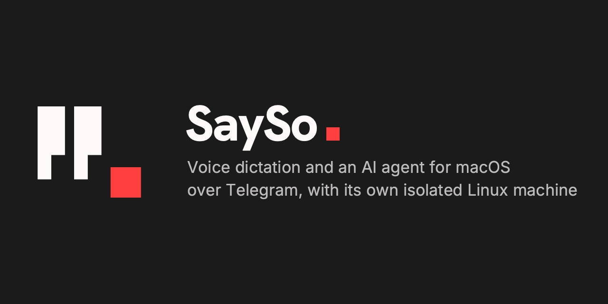
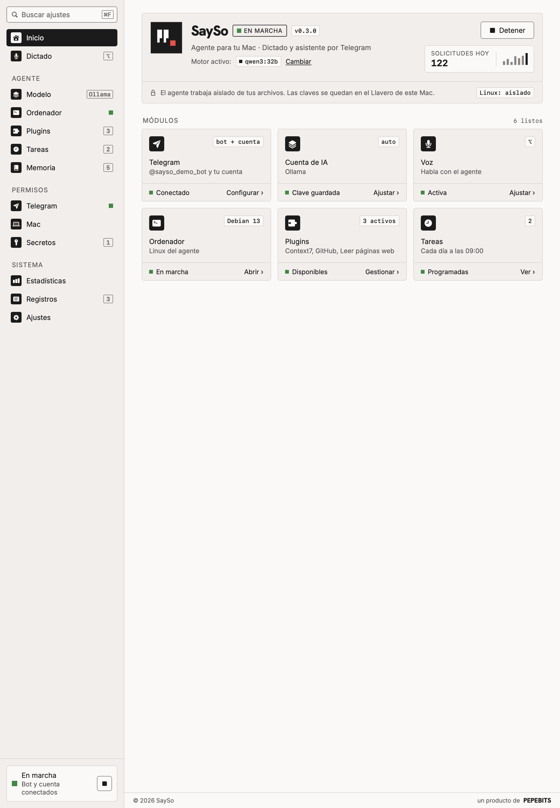
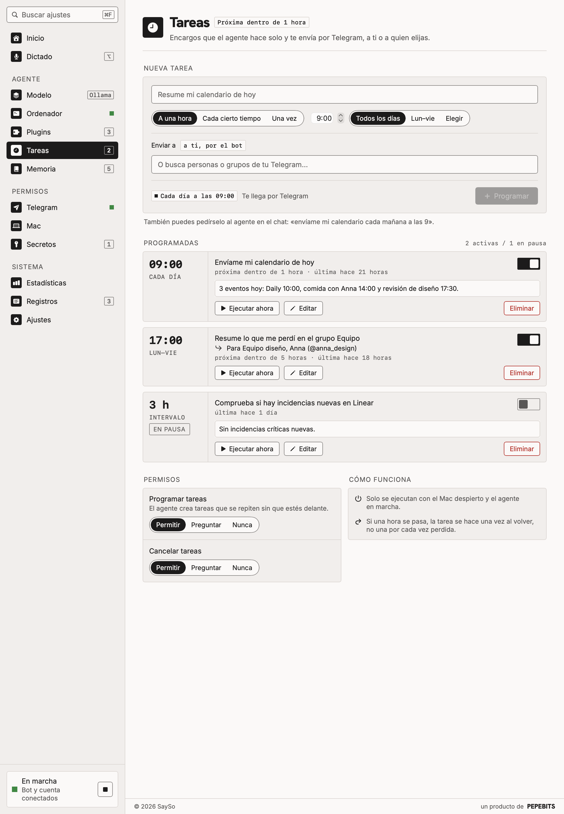

<p align="center"></p>

<p align="center"><em>English · <a href="README.es.md">Español</a></em></p>

**SaySo** is a native macOS app that turns your voice into actions. Hold a key, speak, and an
AI agent does the rest: it answers on screen, writes to your Telegram chats, schedules tasks
and works inside its own Linux machine, never on your Mac. Every action that leaves your Mac
follows rules you set, and asks first when you want it to.

- 🎙️ **Local dictation**: hold ⌥ (or a shortcut you choose) and Whisper transcribes on your Mac, or switch to a continuous conversation with the agent
- 💬 **Telegram, two ways**: talk to the agent through your own bot, and optionally let it read, search, reply to and send from your account (TDLib), voice notes and media included
- 🐧 **An isolated Linux machine** (Virtualization.framework) where the agent runs commands, installs tools, browses the web and transcribes audio
- 🧩 **Plugins** over MCP, plus the agent's own add-ons running in the Linux machine
- ⏰ **Scheduled tasks** with recipients, a calendar for any day, and an option to send without asking
- 🧠 **Editable memory**: notes typed as instructions or facts, used in every conversation
- 🛡️ **Permissions and guardrails**: Allow / Ask / Never per action, secrets in the Keychain and redacted before they reach the model, and a review of outward actions after the agent has read third-party content, with an optional local prompt-injection classifier
- 🔌 **Any model**: Claude, OpenAI, OpenRouter, Grok, or a local model with Ollama or LM Studio
- 🌍 Spanish, English, Galician, French and Portuguese

<p align="center">
  
  
</p>

## 🚀 Getting started

You need **macOS 14 or later on Apple Silicon** and an account with a model provider (or a
local model).

1. 📥 Download the latest `SaySo-x.y.z.dmg` from [Releases](https://github.com/Pepebits/sayso/releases). It is signed and notarized.
2. 📂 Drag SaySo to Applications and open it. The welcome guide asks for the microphone and Input Monitoring permissions, and walks you through the rest.
3. 🤖 Optional: create a bot with [@BotFather](https://t.me/BotFather) and paste its token in **Telegram**, and sign in with your account if you want the agent to work on your chats. The account needs your own `api_id` and `api_hash` from [my.telegram.org](https://my.telegram.org).

## 🛠️ Building from source

Requires Xcode 16 or later (Swift 6 toolchain).

```bash
git clone https://github.com/Pepebits/sayso.git
cd sayso
scripts/make-app.sh          # builds build/SaySo.app (debug)
open build/SaySo.app
```

`scripts/make-app.sh release` builds a release version. `scripts/release.sh` signs it with
Developer ID, notarizes it and packages the DMG; the script header lists what it needs once.

## 🧪 Tests

```bash
swift test
```

`scripts/check-strings.py <code>` checks that a translation has every key and placeholder of
the English one.

## 📚 Documentation

- 🗺️ **[Plan and status](docs/PLAN.md)**: features, phases and what is verified (in Spanish)
- 🧭 **[Architecture decisions](docs/adr/README.md)**: why a native app, a Linux VM, TDLib, one permission engine… (in Spanish)

## 🔒 Privacy

Dictation is transcribed on your Mac. Conversations, memory, tasks and the activity log are
stored locally in SQLite, and secrets in the Keychain. What reaches the model provider is what
you say to the agent and what its tools read for that request. SaySo has no server and sends
no telemetry.

## 📄 License

[MIT](LICENSE) © Pepebits. Third-party components and their licenses are listed in
[ThirdPartyNotices.txt](Resources/ThirdPartyNotices.txt).
