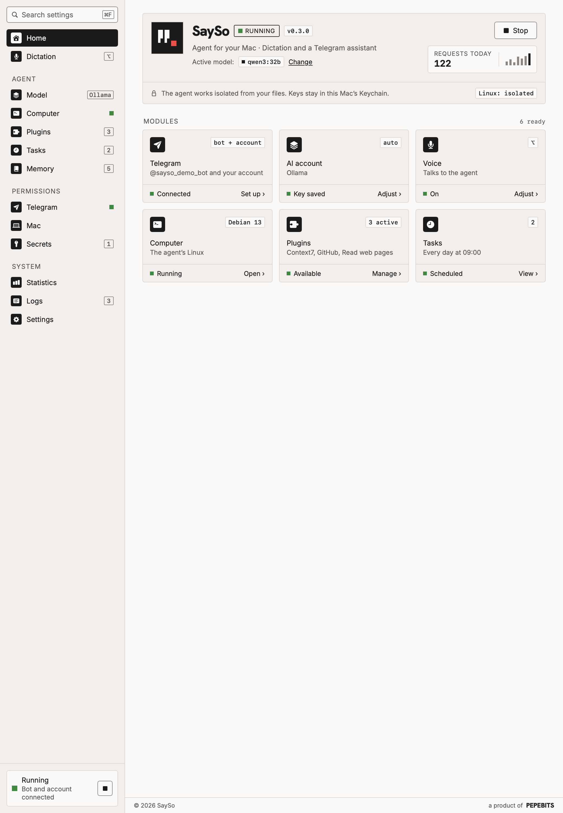
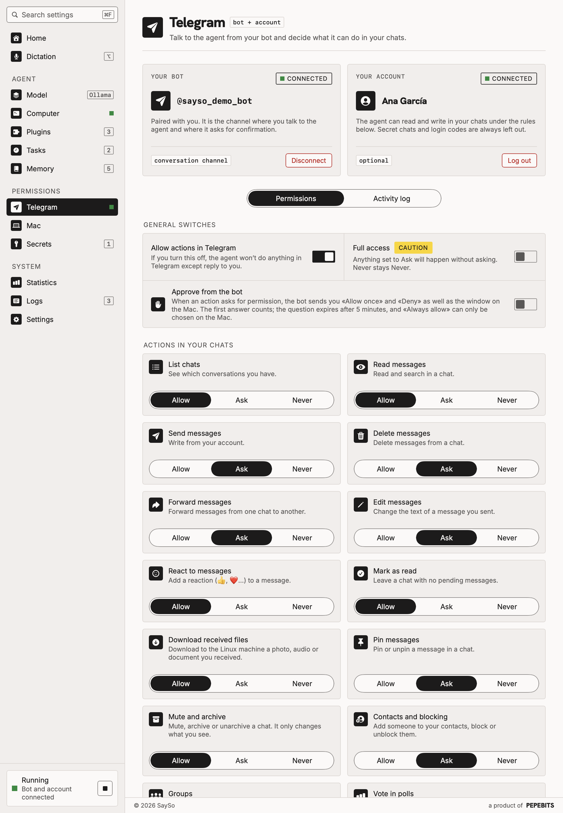

<p align="center"></p>

<p align="center"><em>English · <a href="README.es.md">Español</a></em></p>

**SaySo** is a native macOS app that turns what you say into things done. Hold a key and
speak: an AI agent answers on screen, writes in your Telegram chats, schedules tasks and runs
commands in a Linux machine of its own, away from your files. Anything that leaves your Mac
goes through rules you set, and asks you first when you want it to.

- 🎙️ **Dictation on your Mac**: hold ⌥, or a shortcut of your choice, and Whisper transcribes locally; or keep a spoken conversation going with the agent
- 💬 **Telegram, two ways**: talk to the agent through your own bot, and if you want, let it read, search, reply, forward and send from your account, voice notes and media included
- 🐧 **Its own Linux machine**, isolated with Virtualization.framework, to run commands, install tools, browse the web and transcribe audio
- ⏰ **Scheduled tasks** for you or for other people, with several recipients and an option to send without asking
- 🧠 **Memory you can edit**: notes marked as instructions or facts, applied in every conversation
- 🧩 **Plugins** over MCP, plus add-ons that run inside the Linux machine
- 🛡️ **Permissions and guardrails**: Allow, Ask or Never for each action, secrets kept in the Keychain and redacted before they reach the model, and a second check on outward actions after the agent has read someone else's content
- 🔌 **Bring your own model**: Claude, OpenAI, OpenRouter, Grok, or a local one with Ollama or LM Studio
- 🌍 In Spanish, English, Galician, French and Portuguese

<p align="center">
  
  
</p>

## 🚀 Getting started

You need **macOS 15 or later on Apple Silicon**, and an account with a model provider or a
local model.

1. 📥 **Download** the latest `SaySo-x.y.z.dmg` from [Releases](https://github.com/Pepebits/sayso/releases). It is signed and notarized by Apple.
2. 📂 **Install**: drag SaySo to Applications and open it. The welcome guide asks for the microphone and Input Monitoring, and takes you through the rest.
3. 🔑 **Pick a model** under **Model**: paste an API key, which goes to the Keychain, or point it at Ollama or LM Studio.
4. 🤖 **Optional, Telegram**: create a bot with [@BotFather](https://t.me/BotFather) and paste its token under **Telegram**. To let the agent work on your own chats, sign in with your account too, using an `api_id` and `api_hash` of your own from [my.telegram.org](https://my.telegram.org).

With Homebrew, steps 1 and 2 are one command:

```bash
brew install --cask pepebits/sayso/sayso
```

The first time, add the tap and trust it (Homebrew 7 asks for this with taps outside Homebrew):
`brew tap pepebits/sayso https://github.com/Pepebits/sayso && brew trust pepebits/sayso`.
SaySo then updates itself: it checks for new versions once a day and asks before installing one.

## 🧭 How it works

```
 voice ─▶ Dictation ─┐                       ┌─▶ Telegram bot and account
                     ├─▶ Agent ─▶ Permissions ┼─▶ Mac: calendar, reminders, notes
 Telegram bot ───────┘     │                  └─▶ Linux machine: commands, web, plugins
                           └─▶ model provider
```

The agent loop runs on the Mac and talks to the model provider you choose. Every action with an
effect outside the Linux machine goes through one permission engine, which allows it, asks you
on the Mac or refuses it, and logs what happened. Code the agent writes or downloads runs only in the Linux machine.

| Module | What it does |
|---|---|
| `SaySoCore` | Shared models and contracts, no dependencies |
| `SaySoStore` | SQLite with GRDB: rules, activity, memory, tasks, conversations |
| `SaySoPermissions` | Permission engine, Mac scripts, Keychain and secret redaction |
| `SaySoAgent` | Model providers, agent loop, tools, Telegram bot, MCP client, guardrails |
| `SaySoDictation` | Global shortcut, audio capture and Whisper transcription |
| `SaySoVM` | The Linux machine, with Virtualization.framework |
| `SaySoTDLib` | Optional Telegram user session through TDLib |
| `SaySoUI` | Design system and every screen |
| `SaySoApp` | The app: wires it all together |

## 🛠️ Building from source

Requires Xcode 16 or later (Swift 6 toolchain).

```bash
git clone https://github.com/Pepebits/sayso.git
cd sayso
scripts/make-app.sh
open build/SaySo.app
```

`scripts/make-app.sh` builds `build/SaySo.app` in debug; pass `release` for an optimized
build. It signs with your Developer ID if the Keychain has one, so macOS keeps the permissions
you granted between builds. `scripts/release.sh` signs, notarizes and packages the DMG; its
header lists what it needs the first time.

## 🧪 Tests

```bash
swift test
```

To render every screen to PNG, in light and dark:

```bash
SAYSO_SCREENSHOTS=/tmp/sayso SAYSO_SCREENSHOTS_LANG=en swift test --filter ScreenSnapshotTests
```

`scripts/check-strings.py <code>` checks that a translation has every key and placeholder of
the English one.

## 🔒 Privacy

Dictation is transcribed on your Mac. Conversations, memory, tasks and the activity log stay
on it in SQLite, and secrets in the Keychain. The model provider receives what you ask the
agent and what its tools read to answer you. SaySo has no server of its own and sends no
telemetry.

## 📄 License

[MIT](LICENSE) © Pepebits. Third-party components and their licenses are listed in
[ThirdPartyNotices.txt](Resources/ThirdPartyNotices.txt).
